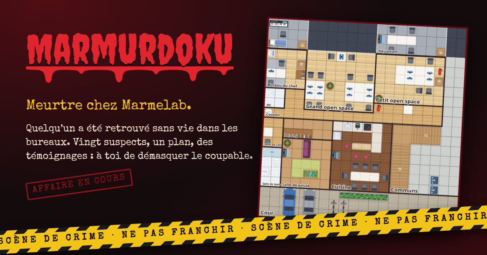

<p align="center">
  <a href="https://marmerdoku.vercel.app">
    
  </a>
</p>

<h3 align="center">Quelqu'un a été retrouvé sans vie dans les bureaux de Marmelab.</h3>

<p align="center">
  Vingt suspects. Un plan. Des témoignages qui ne mentent pas.<br />
  À toi de reconstituer la scène, et de démasquer le coupable.
</p>

<p align="center">
  <a href="https://marmerdoku.vercel.app"><strong>🔪 Ouvrir l'enquête</strong></a>
</p>

<p align="center">
  
  
  
  
</p>

---

**Marmerdoku** est un niveau de Murdoku, le casse-tête
de logique où l'on résout un meurtre case par case. Le plateau est le vrai plan
des bureaux de Marmelab, les suspects sont ceux qui y travaillent. Une seule
solution, et elle se trouve par la déduction, jamais au hasard.

- 🗺️ Un plan des bureaux dessiné à la main, meuble par meuble
- 🕵️ Des carnets de notes, une gomme qui remonte le temps, des dossiers à sauvegarder
- 🎬 Une surprise pour qui résout l'affaire

## Mener l'enquête en local

```sh
nvm use
make install
make start   # http://localhost:2020
```

`make help` liste toutes les commandes, `make check` vérifie tout (build, lint,
types, code mort, tests).

## Licence

MIT, voir [LICENSE](./LICENSE).
